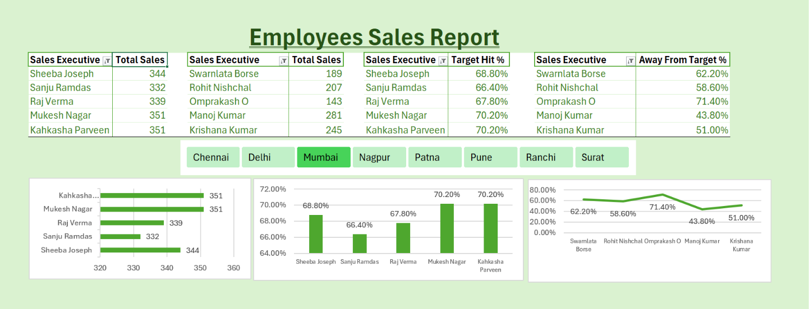

# Employee Sales Performance Dashboard

## Project Overview

This project uses Microsoft Excel to analyse employee sales performance and present the results through an interactive dashboard.

The dashboard provides an overview of individual salesperson performance, regional sales, and target achievement, making it easier to compare results and identify performance differences.

## Project Objectives

- Analyse sales performance across different employees.
- Compare salesperson performance.
- Understand regional sales distribution.
- Track individual target achievement.
- Identify employees performing above or below expectations.

## Tools & Features

**Tools Used:**
- Microsoft Excel
- PivotTables
- PivotCharts
- Excel Slicers
- Excel Formulas

**Dashboard Features:**
- Salesperson-wise sales comparison.
- Top and bottom salesperson performance.
- Target achievement percentage.
- Performance gap against sales targets.
- Interactive region-based filtering.
- Visual comparison through charts.

## Dataset

The workbook contains sales records for:

- 141 sales executives.
- 8 regions.
- Daily sales figures across 5 days.
- Individual sales targets.
- Calculated total sales and target achievement percentages.

## Workbook Structure

| Sheet | Description |
|---|---|
| Dashboard | Interactive sales performance report |
| Raw Data | Employee-level sales records and calculated metrics |

## Key Learning

Through this project, I practised using Excel to organise sales data, create PivotTables, build charts, apply slicers, and present business information through a dashboard.

This project is part of my ongoing learning journey in data analysis.

---

**Tools:** Microsoft Excel | PivotTables | PivotCharts | Slicers

## Dashboard Preview

